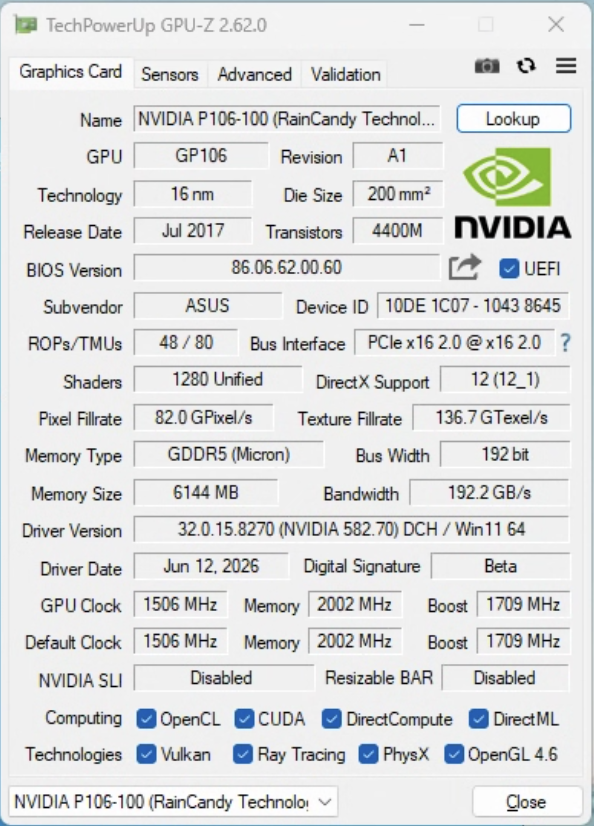

# P106 Unlock Gen2

## 中文说明

这是一个面向 NVIDIA P106 系列矿卡的 PCIe Gen2 解锁工具。



支持设备：

| Device ID | 型号 |
|---|---|
| `10DE:1C06` | P106-100 |
| `10DE:1C07` | P106-100 备用 ID |
| `10DE:1C09` | P106-090 |

工具会把 P106 的 PCIe 链路从默认 `Gen1` 提升到 `Gen2`，并注册开机自启任务，
在开机、登录后自动补写寄存器，防止链路掉回 Gen1。

> 本项目会加载 WinRing0 / ThrottleStop 内核驱动，并访问 GPU BAR0 和 PCI
> 配置空间。请在可恢复平台上测试。杀毒软件可能将这两个驱动标记为 BYOVD
> 风险工具。

### 运行包

本目录同时包含源码、驱动、脚本和说明。Windows 上运行：

```text
build.cmd       编译源码，生成 bin\P106Gen2x4.exe
probe.cmd       只读探针，不写 GPU 寄存器
try-once.cmd    一次性解锁测试
install.cmd     安装并注册开机自启任务
status.cmd      查看当前链路状态
uninstall.cmd   卸载并还原
```

### 快速开始

1. 关闭 Windows 的“易受攻击的驱动程序阻止列表”，然后重启。
2. 右键 `probe.cmd`，以管理员身份运行。
3. 确认设备 ID 和 BAR0 镜像指纹为 `MATCH`。
4. 右键 `try-once.cmd`，以管理员身份运行。
5. 成功后右键 `install.cmd`，以管理员身份运行。
6. 重启电脑，等待 1-3 分钟。
7. 运行 `status.cmd` 查看是否稳定在 Gen2。

### 设备 ID 参数

所有脚本都支持额外参数：

```text
-dev 1c06
-dev 1c07
-dev 1c09
```

例如：

```text
probe.cmd -dev 1c07
try-once.cmd -dev 1c09
status.cmd -dev 1c06
```

不传 `-dev` 时，程序按 `1C06 -> 1C09 -> 1C07` 顺序自动查找。

### 开机自启

`install.cmd` 会注册计划任务：

```text
P106 PCIe Gen2 Bring-up
```

触发条件：

```text
开机后 60 秒
登录后 15 秒
每 1 分钟自愈一次
```

### 源码结构

```text
.
├── README.md
├── build.cmd
├── probe.cmd
├── try-once.cmd
├── install.cmd
├── status.cmd
├── uninstall.cmd
├── src/
│   └── P106Gen2x4.cs
├── bin/
│   ├── drivers/
│   │   ├── WinRing0x64.sys
│   │   └── ThrottleStop.sys
│   ├── check-bw.cmd
│   ├── bw_test.py
│   └── vbios.cmd
└── docs/
```

### 免责声明

本项目仅用于研究和恢复自有硬件。错误操作可能导致掉卡、无法启动或需要恢复
BIOS。请自行备份并承担风险。

---

## English

A PCIe Gen2 unlock tool for NVIDIA P106 mining cards.

Supported devices:

| Device ID | Model |
|---|---|
| `10DE:1C06` | P106-100 |
| `10DE:1C07` | P106-100 alternate ID |
| `10DE:1C09` | P106-090 |

The tool raises the P106 PCIe link from `Gen1` to `Gen2` and registers a
scheduled task that re-applies the required registers after boot and logon.

> This project loads the WinRing0 / ThrottleStop kernel drivers and accesses
> GPU BAR0 and PCI configuration space. Test on a recoverable system.
> Antivirus software may flag these drivers as BYOVD risk tools.

### Runtime Package

This directory includes source code, drivers, scripts, and documentation. On
Windows:

```text
build.cmd       Build source and generate bin\P106Gen2x4.exe
probe.cmd       Read-only probe; does not write GPU registers
try-once.cmd    One-pass unlock test
install.cmd     Install and register the autostart task
status.cmd      Show current link status
uninstall.cmd   Uninstall and restore
```

### Quick Start

1. Disable the Microsoft vulnerable driver blocklist, then reboot.
2. Right-click `probe.cmd` and run as Administrator.
3. Confirm the device ID and `BAR0 mirror fingerprint: MATCH`.
4. Right-click `try-once.cmd` and run as Administrator.
5. If it reaches Gen2, right-click `install.cmd` and run as Administrator.
6. Reboot and wait 1-3 minutes.
7. Run `status.cmd` to verify the link remains at Gen2.

### Device ID Arguments

All scripts accept:

```text
-dev 1c06
-dev 1c07
-dev 1c09
```

Examples:

```text
probe.cmd -dev 1c07
try-once.cmd -dev 1c09
status.cmd -dev 1c06
```

Without `-dev`, the tool searches in this order: `1C06 -> 1C09 -> 1C07`.

### Autostart

`install.cmd` registers:

```text
P106 PCIe Gen2 Bring-up
```

Triggers:

```text
60 seconds after boot
15 seconds after logon
every 1 minute for self-healing
```

### Repository Layout

```text
.
├── README.md
├── build.cmd
├── probe.cmd
├── try-once.cmd
├── install.cmd
├── status.cmd
├── uninstall.cmd
├── src/
│   └── P106Gen2x4.cs
├── bin/
│   ├── drivers/
│   ├── check-bw.cmd
│   ├── bw_test.py
│   └── vbios.cmd
└── docs/
```

### Disclaimer

This project is for research and recovery of hardware you own. Incorrect use
may cause GPU link loss, boot failure, or BIOS recovery. Back up your system
and accept the risk before use.
